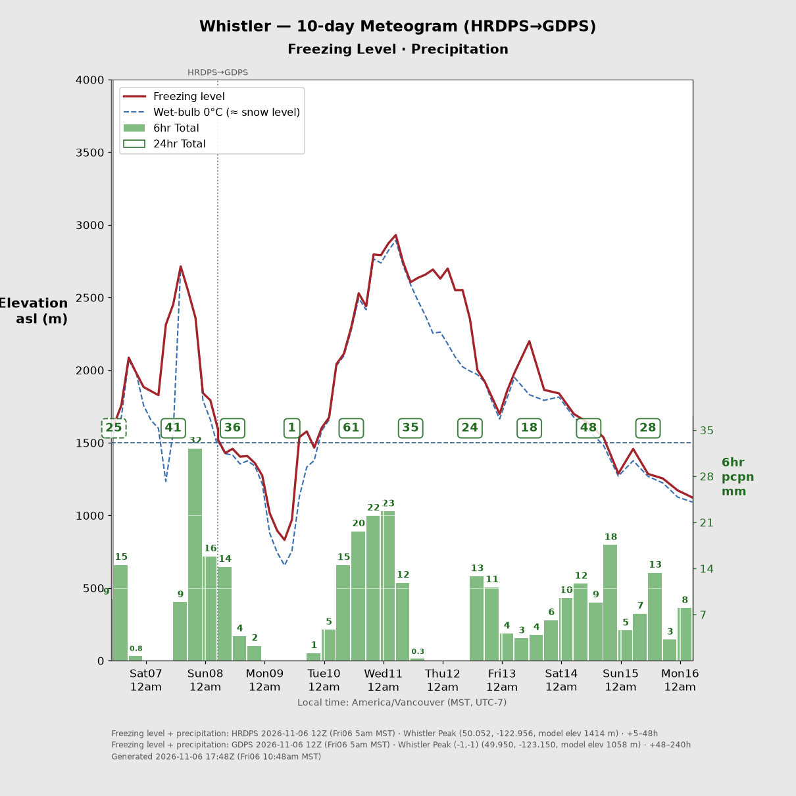
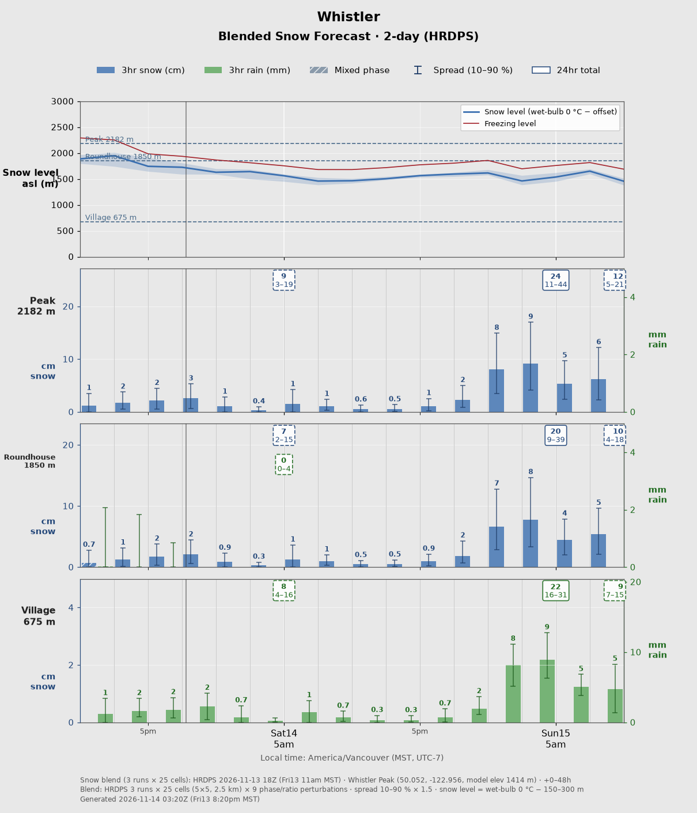

# Ski Forecast Generator

Automatic ski-forecast meteograms (freezing level, wet-bulb snow level, precipitation, optional ridge-top wind) and **Blended Snow Forecasts** (snow and rain per elevation with a margin of error) built from Environment Canada's free [MSC Datamart](https://dd.weather.gc.ca/) model output, posted to Discord every time a model publishes a new run or on a schedule.
Inspired by PowderPicker, please support him on [Substack](https://powderpicker.substack.com/)!





## How it works

1. Every `poll_interval_minutes` (default 5), the service checks each model used by your charts for a new run.
2. A run counts as ready once every file the charts need for its first and last forecast hours has been published.
3. When a run is ready, the service downloads only the files it needs. That means the pressure levels from the surface up to `profile_top_hpa`, plus surface pressure and accumulated precipitation. It reads the values at your grid points (and, for blended snow charts, the cells around them) and deletes each file straight away. Only small JSON extracts are kept, in `data/runs/`.
4. It computes the freezing level and the wet-bulb 0 °C height (≈ snow level) from the vertical temperature/dewpoint profile. It also computes model ground elevation from surface pressure and, optionally, wind interpolated to a chosen elevation.
5. Every chart that uses an updated model is re-rendered (`data/charts/<id>/latest.png`) and posted to its webhook, unless the chart has its own posting rule (`post:`, see below).

### Built-in models

| key | model | runs (UTC) | range | notes |
|---|---|---|---|---|
| `hrdps` | HRDPS 2.5 km continental | 00/06/12/18 | 48 h | upper air every 3 h by default (`profile_step_hours`), precip hourly |
| `hrdps_west` | HRDPS 1 km West (experimental, `dd.alpha`) | 00/12 | 48 h | ~6 h publication delay, 24 h history |
| `rdps` | RDPS 10 km | 00/06/12/18 | 84 h | |
| `gdps` | GDPS 15 km | 00/12 | 240 h | upper air every 3 h |

All four use the same pipeline. A new Datamart model only needs URL/filename templates and variable names in `config.yaml` under `models:`, and you can override any built-in field there too. See `skiforecast/models.py` for the format.

## Quick start

```bash
cp .env.example .env                              # put your Discord webhook URLs here
cp config/config.example.yaml config/config.yaml  # edit points + charts
docker compose build
docker compose run --rm skiforecast check-config  # validates config, estimates download volume
docker compose run --rm skiforecast test-discord alerts
docker compose up -d
docker compose logs -f
```

The first start processes the latest run of every model, which takes several minutes, and then posts all charts (`post_on_startup`).

### Commands

`docker compose run --rm skiforecast <command>`

| command | what it does |
|---|---|
| `run` | the service (default) |
| `once` | one poll cycle, then exit |
| `check-config` | validate config and print a summary + GB/day estimate |
| `render <chart> [--post]` | re-render a chart from stored data (handy after style tweaks) |
| `test-discord <chart-id or alerts>` | send a test message |
| `healthcheck` | used by the Docker healthcheck (heartbeat age) |

## Configuration

See `config/config.example.yaml`. The main ideas:

**Points** are named lat/lon locations. A chart source references a point and can shift it by whole grid cells with `offset: [east, north]`. For example, `[-1, -1]` is one cell left and one down, which is the SpotWX "move a tile" trick. The chart footer prints the grid cell actually used and the model's ground elevation there, so you can check your choice.

**Charts** have two layers, each an ordered list of sources:

```yaml
freezing_level:
  - { model: hrdps, point: whistler_peak, until_hour: 48 }    # first 48 h of its run
  - { model: gdps,  point: whistler_peak, offset: [-1, -1] }  # then GDPS to the end
precipitation:            # optional; defaults to the freezing_level sources
  - { model: gdps, point: whistler_peak, offset: [-1, -1] }
```

- Sources take over from each other in order. Each one covers time from where the previous one ended up to its own `until_hour` (counted from its own run start) or the end of its data.
- A source with no data yet is skipped, so a list doubles as a fallback chain. For example, `hrdps_west` then `hrdps` uses HRDPS whenever the experimental 1 km run is late.
- Freezing level and precipitation can use completely different models and points.

Other per-chart options:

- `hours` and `history_hours`: chart length, and how much past time to keep.
- `trim_to_data`: end the chart where the model data ends instead of at `hours`, so a GDPS run that is a few hours old doesn't leave empty space on the right.
- `freezing_level_method`: `highest` (the top of any warm layer, above which everything is frozen) or `lowest`.
- `show_wetbulb_zero`: draws the dashed snow-level estimate.
- Precipitation: `precip_bar_hours`, `precip_total_hours` and `precip_total_start_hour_local` (boxed totals; local hour). By default the totals start at the x-axis day marker: `style.tick_hour_utc` if set, otherwise local midnight. Bars and totals are aligned to that hour, snapped to the nearest output step of the precip models (3-hourly GDPS can't start exactly at every hour).
- `wind`: `enabled`, `elevation_m`, `every_hours`, and which layer's sources to use.
- `reference_lines`: horizontal elevation markers.
- `style`: size, axis limits, colours, footer, model-transition marker and now line.
  - `tick_hour_utc`: Zulu hour of the daily x-axis marker, e.g. `12` for 12Z. Leave it unset for local midnight (the default). Marker labels are always in local time.
  - `min_ticks_per_day`: minimum number of x-axis markers per day, 1–11 (default 1). The step is the largest of 24/12/8/6/4/3/2 h that gives at least that many, so 4 means every 6 h and 7–11 mean every 2–3 h.

Times on the chart are in `general.timezone`, which is printed under the x axis. Model run times (footer and Discord message) are shown in UTC with the local time in brackets, e.g. `2026-11-06 00Z (Thu05 5pm MST)`.
- Discord: `webhook` (per chart, otherwise `discord.default_webhook`), `message` (text sent with the image, e.g. `@here`) and `min_post_interval_minutes`.

Titles can use `{fl_models}` and `{precip_models}`, e.g. `"Whistler — 10-day ({fl_models})"` becomes `HRDPS→GDPS`.

**Posting** (`post:` per chart). By default a chart is posted whenever any model it uses has a new run. With four models feeding one chart that is a lot of posts, so you can narrow it:

```yaml
post:
  models: [hrdps]              # only new HRDPS runs trigger a post; the other models are still used for the data
```

or post on a schedule instead of on updates:

```yaml
post:
  times: ["06:00", "17:00"]    # local time (general.timezone); the latest data at that moment is posted
```

When `times` is set, model updates never trigger a post on their own. If the service was down over several scheduled times, it posts once, for the latest one. `min_post_interval_minutes` and `post_on_startup` apply to both modes.

### Blended Snow Forecast

A second chart type (`type: blended_snow`) that answers "how much snow, and how sure is that?" for a few elevations at one point:

- A top panel with the snow level (wet-bulb 0 °C height minus an offset) and its spread, with your elevations marked.
- One panel per elevation (highest first) with a snow bar (cm) and a rain bar (mm) for every `bar_hours` slot. Each bar prints its central value; the whisker is the spread (10th to 90th percentile). Hatched bars mean the phase could go either way. Daily totals sit at the end of their period as a narrow stack: snow total over its `low–high` range, then rain total over its range, without units (the legend has them). A dashed box is a period the chart does not fully cover.

```yaml
- id: snow_2day
  type: blended_snow
  title: "Whistler"
  subtitle: "Blended Snow Forecast · 2-day ({models})"
  hours: 48
  sources:
    - { model: hrdps, point: whistler_peak }
    - { model: gdps, point: whistler_peak }      # optional hand-over, same rules as the meteogram
  elevations:
    - { elevation: 2182, label: Peak }
    - { elevation: 1850, label: Roundhouse }
    - { elevation: 675, label: Village }
  bar_hours: 3
  total_hours: 24
  post: { models: [hrdps] }
```

`sources` is one chain used for both the profile and the precipitation. `elevations` takes 1–5 entries, as numbers or `{elevation, label}`. `bar_hours`, `total_hours`, `total_start_hour_local`, `hours`, `trim_to_data`, `post` and the `style` keys `tick_hour_utc` / `min_ticks_per_day` work like the meteogram's. The chart starts at the first source's run time (a 12Z HRDPS run gives 12Z to 12Z two days later); set `start_at_run: false` to start at now minus `history_hours` like the meteogram. `style.show_bar_ranges: true` also prints `low–high` under every bar value. Thin lines separate the slots so each snow/rain pair reads as one (`style.show_slot_separators`, `style.slot_separator_color`).

**How the numbers are made.** For each elevation and time slot the model's temperature, dewpoint and (optionally) wind profiles are interpolated to that height:

1. The wet-bulb temperature at the elevation decides the phase: all snow at or below 0 °C, all rain at or above 1.5 °C, a linear ramp between (Jennings et al. 2018). Snow reaches below the wet-bulb 0 °C height, so the wet-bulb is taken from 150 m higher, up to 300 m in heavy precipitation (Minder, Durran & Roe 2011).
2. The snow-to-liquid ratio comes from the air temperature at the elevation, a lookup in the spirit of Dubé (2003) and Baxter et al. (2005): about 9:1 near 0 °C, peaking around 19:1 near −15 °C, falling again in very cold air. With `blend.use_wind: true` strong wind at the elevation lowers the ratio (Alcott & Steenburgh 2010); this downloads the wind files too.
3. Snow cm = liquid precipitation × snow fraction × ratio; rain mm = liquid × (1 − snow fraction).

**Where the spread comes from.** Nothing is trained on observations (the goal is to work at any point), so the margin of error is a *disagreement* measure built from data the service already has:

- the model's last `blend.lagged_runs` runs (default 3; needs `general.keep_runs` at least that high),
- the grid cells within `blend.neighbourhood_km` of the point (default 6 km: 5×5 cells for HRDPS, 3×3 for RDPS, the single cell for GDPS), weighted towards cells whose model terrain is close to the panel's elevation,
- fixed perturbations: ±`temperature_sigma_c` on the wet-bulb (default 1 °C) and ±`ratio_spread` on the ratio (default 30 %).

Every combination is a member; the centre is the weighted median and the spread the 10th–90th percentile, multiplied by `blend.widen` (default 1.5) because ensembles of this kind agree with each other more than with reality, with a floor of ±20 % (±2 cm on daily totals). Totals are summed per member before taking percentiles, so they are not the sum of the bar spreads. Expect the spread to jump where one model hands over to another: fewer runs and cells feed the coarser model. The chart footer prints the recipe.

What to expect from it: a day 1–2 daily total within roughly a factor of 1.5 most days, phase right when the elevation is clearly above or below the snow level, and a visibly wider spread when runs or neighbouring cells disagree. It does not fix a model's systematic bias at your point, so if HRDPS always under-forecasts your summit, all its runs will agree on the wrong number.

**Alerts** (`discord.alerts_webhook`) cover start-up, processing or rendering errors and a model going stale (`stale_after_hours` per model). A recovery notice follows each one, and repeats are throttled by `alert_repeat_hours`.

### Bandwidth

The Datamart serves whole national or global grids, so a point forecast still has to download full files. `check-config` prints an estimate. The example config uses about 25 GB/day, and nothing is kept on disk. To reduce it:

- Raise `profile_step_hours`.
- Lower `profile_top_hpa`. The default of 600 hPa is about 4.2 km.
- Turn off `show_wetbulb_zero` (saves the dewpoint files).
- Turn off wind.
- Use `until_hour` to stop a model earlier.

## Notes on accuracy

- The freezing level is a height above sea level taken from the model atmosphere, so it hardly depends on which grid cell you pick. Precipitation does depend on the cell, through orographic effects in the model terrain.
- The wet-bulb 0 °C height is a good first guess at the snow level during precipitation. Snow often reaches 100–300 m lower in heavy precipitation.
- The blended snow spread is under-dispersive by construction (same model family, no observations). Read it as "how much the recent runs, the surrounding terrain and the phase physics disagree", not as a statistical confidence interval.
- HRDPS-West is an experimental product with no guaranteed availability.
